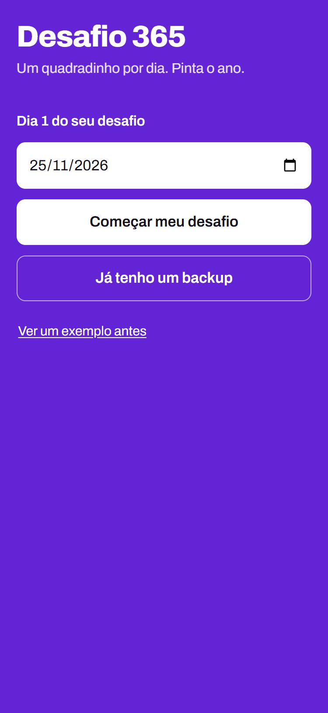
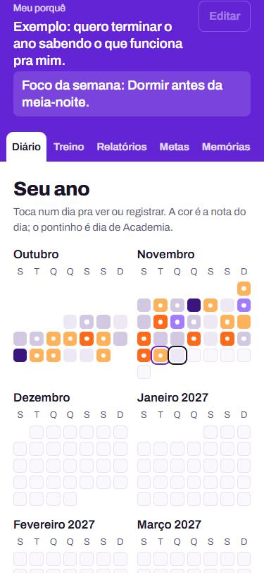
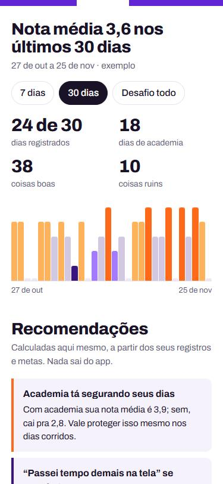
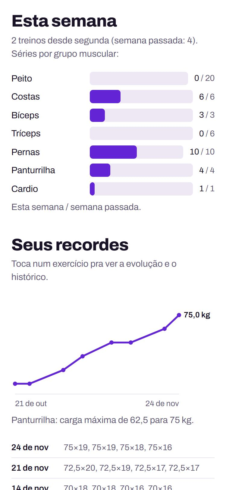

# Desafio 365

Diário de um desafio de 365 dias, para Android. Um quadradinho por dia, pintado pela nota que você dá. Junta diário, treino, metas, relatórios e memórias num app só, **sem conta, sem servidor e sem permissão de internet**.

<p>
  
  
  
  
</p>

*As imagens usam os dados fictícios do modo exemplo.*

## O que faz

- **Diário:** nota do dia, sentimentos, hábitos, coisas boas e ruins com o porquê de cada uma, fotos, sono, peso e pergunta do dia.
- **Treino:** rotinas, séries, sugestão de carga, timer de descanso, recordes e volume por semana.
- **Relatórios:** padrões e recomendações calculados no próprio aparelho.
- **Metas e memórias:** passos e prazos, marcos, cartas para o futuro e revisão semanal.

## Privacidade como requisito

| Decisão | Efeito |
|---|---|
| O manifesto não pede `INTERNET` | O Android impede o app de se conectar |
| Content-Security-Policy só com `'self'` | A página também não consegue chamar nada de fora |
| `allowBackup=false` e regras de extração | Nada vai para o backup do Google nem para outro celular |
| `BiometricPrompt` e `FLAG_SECURE` | Digital ou PIN para abrir, conteúdo escondido nos recentes e em prints |
| Backup com senha | AES-256-GCM em blocos, chave por PBKDF2-SHA-256 com 600 mil iterações |
| Foto recriada antes de salvar | A localização gravada na imagem se perde |

Sem internet, a **análise com IA** funciona por copiar e colar: o app monta o pedido, a pessoa leva para a IA que quiser e traz o JSON de volta, que é validado antes de aparecer.

## Como é feito

- **Telas:** HTML, CSS e JavaScript puro, sem framework.
- **Dados:** IndexedDB, com uma cópia automática dos textos na área privada do app.
- **Android:** Java com a API do sistema, sem bibliotecas de terceiros. Um WebView carrega as telas de dentro do APK.
- **Montagem:** um script Node chama `aapt2`, `javac`, `d8` e `apksigner` direto, sem Gradle. O APK tem menos de 300 KB.
- **Também roda no navegador** como PWA, com service worker e uso offline.

| Arquivo | Papel |
|---|---|
| `app/app.js` | Telas e regras |
| `app/banco.js` | IndexedDB e regra do lembrete |
| `app/plataforma.js` | Fotos, voz, IA, zip e criptografia |
| `app/nativo.js` ↔ `android/.../Ponte.java` | Ponte entre a página e o celular |
| `android/.../MainActivity.java` | Janela, WebView e trava |
| `android/.../Lembrete.java`, `Regra.java` | Alarme diário |
| `ferramentas/apk.mjs` | Gera e assina o APK |

## Rodar

No navegador:

```
node ferramentas/servidor.mjs
```

Para gerar o APK, crie `ferramentas/local.json` com as pastas do Android SDK (build-tools e platform 36) e do JDK:

```json
{ "android": "pasta/do/sdk", "java": "pasta/do/jdk" }
```

```
node ferramentas/apk.mjs
```

A chave de assinatura é criada na primeira vez em `android/chave`, que fica fora do repositório.

O [guia de uso](GUIA.md) explica instalação, lembrete, backup e IA. Fonte Archivo sob a [SIL OFL](app/fontes/OFL.txt).
